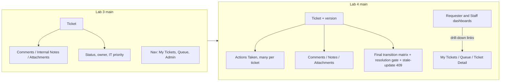

# Lab 4 Plan (v2): Actions Taken, Dashboards, Final Regression

Source: `SE+Lab+4.pdf`, all 11 pages read, including the two dashboard mockups on pp.5-6. Base: `main` at c43937c.
Owner rules from the user: every commit/PR/issue/board change is authored by TauForge; PRs, comments, reviews and
merges are done together at the end for Bank848; Claude never merges.

## Before / after

## Requirement coverage (handout section -> where it is delivered)

| Handout | Delivered by |
|---|---|
| 1, 3 Actions Taken fields (date/time, description, result, performed by auto, follow-up?, follow-up note required if follow-up, attachment notes) | 10a model/API, 10d UI |
| 4.3 Roles: Requester views only; IT Staff and Administrator create/update; authorization matrix completed with the AI spec agent; backend enforces | 10-0 matrix, 10a tests (401/403/404) |
| 4.4 BR-01 one ticket per action; BR-02 owner coordinates, any staff may act; remaining BRs numbered by us | 10-0 spec |
| 4.5 Same 8 statuses; refine matrix; backend enforces resolution rule; Requester "appears resolved" stays advisory | 10b |
| 4.6, 6.2 Dashboard metrics: exact names, query, empty behavior, timezone, drill-down; backend-calculated | 10-0 spec, 10c |
| 5, 5.1-5.3 DB increment, no data loss, 2+ justified design decisions, migration + rollback tested, idempotent seed (all statuses, priorities, assigned/unassigned, 0/1/many actions, zero and non-zero dashboards) | 10a |
| 6, 6.1 REST contract in api-spec; stale/concurrent update handling | 10-0, 10a-10c |
| 7, 8.1-8.6 Zen Green shell, Dashboard nav + active indication, metric cards, focus/keyboard/non-color cues, remove obsolete UI, all states | 10d, 10e, 10f |
| 8.5 Regression: Labs 1-3 intact, duplicate-click/retry safe, forms keep data on failure, no console errors/placeholders, README current | 10f |
| 9-10 Spec DD (11 sections) and Test DD (all test types incl. performance-smoke, AC to test mapping) | 10-0 |
| 11-12 Issues, Kanban, branch flow, file tree (`docs/lab-04` x6, `server/tests/lab-04` x4, `client/.../lab-04 tests` x4, `e2e/lab-04` x3, `artifacts/lab-04/screenshots` x3 dirs) | all |
| 13-14 Product DoD and the 9-part PDF | 10-0, 10g, submission |

## Design decisions to put in the spec (handout leaves them open; confirm with user)

1. Performed by = authenticated user, stored server-side, never from the body. AC-01's "approved assignee" is read
   as the authenticated actor. No separate assignee field.
2. Handout wording "assign / complete / cancel / inactive-assignee rejection" (Part 6) maps to ticket behavior shown
   in the Actions Taken screen: assign = Ticket Owner, complete = Resolved, cancel = Cancelled, inactive assignee =
   existing 409 `INVALID_OWNER`.
3. Actions Taken are editable by the performing user or an Administrator, never deletable, listed in stable order
   (`actionAt`, then `id`). "Append-only" in Part 7 is satisfied as no delete and no reordering.
4. Resolution gate: RESOLVED requires at least one Action Taken on the ticket, else 409 `RESOLUTION_REQUIRES_ACTION`.
5. Requesters see all Actions Taken on their own tickets including follow-up and attachment notes (handout 8.3).
6. Stale updates: `Ticket.version` and `ActionTaken.version`; writes send the expected version; mismatch is 409
   `STALE_UPDATE`. Duplicate create on retry: `Idempotency-Key` header, unique per user, plus UI button lock.
7. Check `ticketStatusTransitions.ts` for dead ends (for example a REOPENED ticket with no manual next step) and fix
   them in the refined matrix rather than keeping the Lab 3 gap.

## Dashboards (from the mockups on pp.5-6)

- Requester: cards My Open, In Progress, Waiting for Me, Resolved, Closed (each "View all" to My Tickets with a status
  filter); My Recent Tickets (last 5 updated); Quick Actions (Create Ticket, View My Tickets). Only own tickets.
- IT Staff: cards New, Open, In Progress, Waiting for Requester, My Assigned, plus Unassigned and counts by IT
  Priority; My Recent Tickets; urgent list; my recent Actions Taken (Part 5); Quick Actions (Create Ticket, Search
  Tickets, My Queue); Refresh button. Cards link to the Queue with filter params.
- Administrator: staff dashboard plus active/inactive and per-role user counts.
- Rules: calculated in SQL by the backend; timezone Asia/Bangkok; "recent" = last 7 days; each card documents its
  query, zero state and drill-down. The "from yesterday" deltas in the mockup are optional and not required by text,
  so they are out unless time allows.
- Nav: Staff and Administrator get Dashboard first; Requester gets Dashboard plus My Tickets; active page highlighted.

## Issues and PRs (create issues before coding; PRs opened together at the end)

| Issue / branch (stacked) | Scope | Test files |
|---|---|---|
| 10-0 contract | four spec docs, authorization matrix, final transition matrix, metric formulas, DoD, AI-use log started | n/a |
| 10a actions-foundation | Prisma `ActionTaken`, `Ticket.version`, migration + tested rollback, seed, create/update/list APIs | `actions-taken.api.test.ts`, migration, seed |
| 10b workflow | refined matrix, resolution gate, stale-update, idempotency | `ticket-workflow.api.test.ts` |
| 10c dashboards-api | requester + staff endpoints, SQL cross-check, performance-smoke | `requester-dashboard.api.test.ts`, `staff-dashboard.api.test.ts` |
| 10d actions-ui | panel on Staff Ticket Detail (list, create, view/edit), read-only on Requester detail, status refresh | `ActionsTaken.test.tsx`, `TicketWorkflow.test.tsx` |
| 10e dashboards-ui | both dashboards, nav, states | `StaffDashboard.test.tsx`, `RequesterDashboard.test.tsx` |
| 10f hardening | a11y, console/placeholder cleanup, README, E2E, screenshots, jsdom `App.test.tsx` fix | `actions-taken-flow`, `ticket-resolution`, `dashboards` specs |
| 10g release | `lab4-staging` to `main`, reviewer.md, ai-use.md, board Done | full suite |

Each task is TDD (failing test first), built by a subagent and independently reviewed, as in Lab 3. Mechanical work
(fixtures, boilerplate) goes to haiku-batch; main stays orchestrator.

## End-of-sprint batch (all at once, as the user asked)

1. Local stacked branches, commits as TauForge, no pushing until done.
2. Push all branches, open all PRs against `lab4-staging` as draft, then ask the user before marking ready.
3. Bank848 reviews and merges 10-0 through 10g in order, then `lab4-staging` to `main`.
4. Replies to review comments in one pass, each checked against the PR head commit.
5. Re-query the Kanban board after edits (Lab 3 `item-edit` reported success without changing state).
6. Record peer reviews given on Bank848's repo in reviewer.md.

## Submission PDF (Answer Part 1-9, one file)

Black and white, Times New Roman, Heading style only for "Answer Part N", real screenshots only, links included.
Part 3 needs full server/client/E2E output from `main`; Part 5 needs dashboard-vs-SQL evidence; Parts 5-9 need
screenshots at desktop 1280, tablet 820, mobile 390 for staff dashboard, requester dashboard, actions taken (plus
regression screens for Part 8).

## Risks

- Local `main` has 2 unpushed commits; push or fold in before branching.
- E2E hits the dev database; restore the onboarding fixture after runs.
- Batch review puts load on Bank848 at once; keep PR diffs small via stacking.
